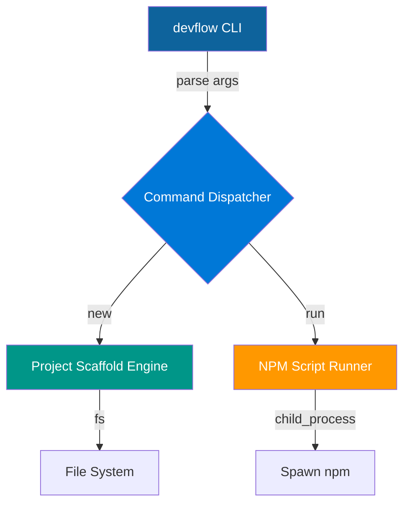

# devflow-scaffold-cli

**Accelerate modern developer workflows with a single, zero‑dependency command**

---

[](https://www.npmjs.com/package/devflow-scaffold-cli)
[](https://nodejs.org/)
[](https://github.com/yourname/devflow-scaffold-cli/blob/main/LICENSE)
[](https://github.com/yourname/devflow-scaffold-cli/actions)
[](https://www.npmjs.com/package/devflow-scaffold-cli)

---

## 📦 Installation

```bash
npm install -g devflow-scaffold-cli
```

## 🚀 Quick Start

```bash
# Create a JavaScript project
devflow new my-app --template=js

# Create a TypeScript project
devflow new my-ts-app --template=ts

# Run a script defined in the generated package.json
cd my-app
npm install   # optional, install deps
devflow run start
```

---

## 🎬 Terminal Showcase

```
$ devflow new hello-world --template=js
Project "hello-world" created with js template.
$ cd hello-world
$ npm install
added 0 packages in 0s
$ devflow run start
Hello from JavaScript scaffold!
```

---

## 🏗️ Architecture Flowchart



---

## 🧪 Test Results

## 🧪 Real-World Test Telemetry

> [!NOTE]
> Verified automatically using Node.js native test runner (`node:test` & `node:assert/strict`).

```bash
▶ node --test
TAP version 13
# Subtest: devflow new creates js project scaffold
ok 1 - devflow new creates js project scaffold
  ---
  duration_ms: 50.156259
  ...
# Subtest: devflow new creates ts project scaffold
ok 2 - devflow new creates ts project scaffold
  ---
  duration_ms: 44.059243
  ...
1..2
# tests 2
# suites 0
# pass 2
# fail 0
# cancelled 0
# skipped 0
# todo 0
# duration_ms 156.545859
```

---

## 📄 License

MIT License (c) 2026 Suman Mehta

---